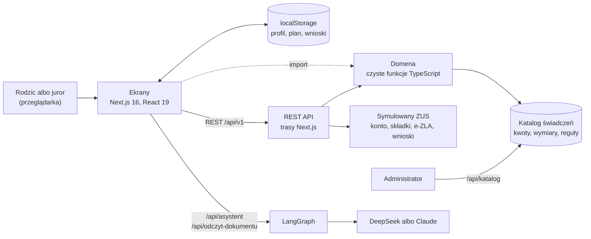

<p align="center">
  
</p>

# ZUS Mama

Projekt na HackNation 2026, wyzwanie ZUS „Zasiłkowy Przewodnik Przyszłego Rodzica” z kampanii „Przewodnik przyszłej mamy”.

ZUS Mama to moduł aplikacji mZUS dla przyszłych i świeżo upieczonych rodziców. Po zalogowaniu czyta dane z konta ZUS, pyta tylko o to, czego na koncie brakuje, i układa plan świadczeń rodziny: co przysługuje, ile wyniesie, do kiedy złożyć wniosek i gdzie. Wnioski do ZUS i wniosek o odpis aktu urodzenia przygotujesz w kreatorach. Przy sprawach w gminie i MOPS przewodnik daje instrukcję i przejście do Emp@tii albo mObywatela.

| Materiał | Link |
| --- | --- |
| Demo | [zus-mama.vercel.app](https://zus-mama.vercel.app) |
| Prezentacja wideo | [YouTube](https://www.youtube.com/watch?v=oNwCVOfmxog) |
| Prezentacja w PDF | [Google Drive](https://drive.google.com/file/d/1rlUu9m9wVllJs7SS8uUQ2DbAQsNdQLx5/view?usp=sharing) |
| Instrukcja dla jury | [Jak sprawdzić rozwiązanie](#jak-sprawdzić-rozwiązanie) |
| Dokumenty przykładowe do wgrania | [dokumenty-przykladowe.zip](https://zus-mama.vercel.app/przyklady/dokumenty-przykladowe.zip) |
| REST API | [/api-docs](https://zus-mama.vercel.app/api-docs), opis [OpenAPI 3.1](https://zus-mama.vercel.app/api/v1/openapi.json) |
| Opis produktu | [docs/01-opis-produktu/opis-produktu.md](docs/01-opis-produktu/opis-produktu.md) |
| Model systemu | [docs/02-model-systemu/model-systemu.md](docs/02-model-systemu/model-systemu.md): 11 elementów systemu w 6 grupach i 4 role |
| User Stories | [docs/03-user-stories/](docs/03-user-stories/): 186 historyjek w 30 Epikach i [tablica komunikatów](docs/03-user-stories/tablica-komunikatow.md) |
| Kod aplikacji | [web/](web/), opis w [web/README.md](web/README.md) |
| AI | Asystent w czacie i odczyt wgranych dokumentów, szczegóły w [Wykorzystanie AI](#wykorzystanie-ai) |

## Jak sprawdzić rozwiązanie

1. Proszę otworzyć [kalkulator zasiłku](https://zus-mama.vercel.app/kalkulator-zasilku), który działa bez logowania, i policzyć zasiłek macierzyński obojga rodziców. Wynik pokazuje podział urlopu między rodziców i porównanie wariantu 81,5% z wariantem 100% i 70%.
2. Na [/demo/wybor-konta](https://zus-mama.vercel.app/demo/wybor-konta) proszę kliknąć przy koncie Anny Nowak „Symuluj stworzenie profilu”. Przewodnik otworzy plan świadczeń rodziny z najbliższymi terminami. W sprawie [Wniosek o zasiłek macierzyński](https://zus-mama.vercel.app/sprawy/K08/instrukcja) przycisk „Wypełnij wniosek” uruchamia kreator ZAM, a jako zaświadczenie lekarskie wystarczy dowolny PDF z [dokumentów przykładowych](https://zus-mama.vercel.app/przyklady/dokumenty-przykladowe.zip).
3. W [przykładowych sprawach](https://zus-mama.vercel.app/przykladowe-sprawy) proszę wybrać sprawę wzorcową, na przykład S01, albo wgrać z dokumentów przykładowych pliki `zam-kowalczyk.pdf`, `z3-kowalczyk.pdf` i `zrzut-kowalczyk.png`. Przewodnik sprawdzi ubezpieczenie chorobowe, policzy świadczenia i porówna wynik z rozstrzygnięciem ZUS.

Pozostałe funkcje i ich adresy zawiera tabela [Funkcje a wymagania wyzwania](#funkcje-a-wymagania-wyzwania). Inne formy zatrudnienia pokazują konta Magdaleny Wójcik z umową o pracę, Karoliny Lis z umową zlecenia i Joanny Mazur z działalnością bez dobrowolnego ubezpieczenia chorobowego, a panel katalogu świadczeń konto Administrator ZUS.

## Funkcje a wymagania wyzwania

| Wymaganie (dokument wymagań ZUS, pkt 3 „Oczekiwany rezultat”) | Gdzie w aplikacji |
| --- | --- |
| a) świadczenia w ciąży, także brak prawa do nich | Etap Ciąża i ekran świadczeń w ciąży: zasiłek chorobowy, świadczenie rehabilitacyjne, zasiłek w wysokości zasiłku macierzyńskiego, przyczyna braku prawa |
| b) zasiłek macierzyński obojga rodziców: liczba dzieci, ich wiek, „Za życiem” | Zintegrowany kalkulator zasiłku `/kalkulator-zasilku` |
| c) łączenie pracy z urlopem rodzicielskim | Wynik kalkulatora, arkusz „Połącz urlop rodzicielski z pracą”: wymiar etatu, wydłużenie urlopu, niższy zasiłek |
| d) symulacja dla obojga rodziców | Arkusz podziału urlopów w wyniku kalkulatora i kalkulator podziału urlopu rodzicielskiego |
| e), j) rodzice adopcyjni i rodzina zastępcza | Kalkulator ze zdarzeniem „Przyjęcie dziecka na wychowanie” i krok „Przyjęcie dziecka” w profilu na start |
| f) indywidualna podstawa wymiaru, symulacja konkretnej sprawy | Podstawa z danych konta ZUS w kalkulatorze i przykładowe sprawy z wgrywaniem dokumentów |
| g) dokumenty, terminy, gdzie złożyć wniosek (pracodawca czy ZUS) | Instrukcja każdej sprawy w planie z płatnikiem zasiłku, dokumentami i kanałem, kalendarz terminów `/terminy` |
| h) ryzyka utraty albo obniżenia świadczeń | Ostrzeżenia strażnika ubezpieczenia chorobowego w planie, ryzyka na ekranie świadczeń w ciąży, stan rozliczeń składek |
| i) organizacje charytatywne w sytuacjach szczególnych | Sytuacje szczególne `/sytuacja-szczegolna` i podmioty wsparcia `/podmioty-wsparcia` |
| zintegrowany kalkulator | `/kalkulator-zasilku` z wyborem zdarzenia, liczby dzieci i formy zatrudnienia obojga rodziców oraz z podziałem urlopów, łączeniem z pracą i wyborem wariantu w wyniku |

| Możliwość (dokument wymagań ZUS, pkt 3) | Realizacja |
| --- | --- |
| logowanie przez mObywatela | Makieta logowania przez mObywatela, eZUS i mZUS na stronie startowej |
| dane z ZUS o ubezpieczeniu albo jego braku, dane wpisane samodzielnie | Odczyt danych z konta ZUS w profilu na start, `/dane-konta-zus`, pytania o brakujące dane |
| stan zadłużenia składek na dzień powstania prawa | `/stan-rozliczen-skladek`: zadłużenie na dzień powstania prawa i wniosek o zaświadczenie o niezaleganiu, a przy zadłużeniu decyzja o odmowie jego wydania |
| podgląd e-ZLA | `/zaswiadczenia-e-zla`, także zwolnienia z kodem B |
| PUE/eZUS: pytanie i dane z konta | `/pytania-do-zus/nowe`, symulowany eZUS z formularzem ZAS-23 |
| wnioski o urlopy i świadczenia | Kreatory ZAM, ZAS-53, Z-15, wniosku przy przyjęciu dziecka i wniosków o urlopy do pracodawcy z wysyłką e-mailem |
| odpis aktu urodzenia | `/wnioski/odpis-aktu-urodzenia` |
| przekierowania do ZUS, MRPiPS i PIP | Odnośniki w instrukcjach spraw i na ekranach informacyjnych |
| panel administracyjny parametrów | `/panel/katalog`: kwoty, progi, stawki, wymiary urlopów, pozycje planu, reguły terminów i słownik dokumentów. `/panel/podmioty-wsparcia`: podmioty wsparcia |

Interfejs dopasowuje układ do telefonu i komputera.

## Architektura



- Domena w `web/src/domena/` liczy okresy, kwoty, terminy i plan. Te same funkcje działają w przeglądarce i w REST API, więc ekran i API dają ten sam wynik.
- Kalkulator, plan i terminy biorą kwoty, stawki i wymiary z katalogu świadczeń. Administrator zmienia je w panelu z datą obowiązywania, bez zmiany kodu.
- W demo serwer symuluje systemy ZUS, a stan symulacji trzyma przeglądarka.
- Błąd REST API ma postać `{ kod, pola?, parametry? }` z kodem z tablicy komunikatów.

## Wykorzystanie AI

Interfejs oznacza wyniki przygotowane przez model.

- Asystent w czacie odpowiada na pytania o plan rodziny. Graf LangGraph klasyfikuje pytanie modelem, a przy błędzie modelu słowami kluczowymi. Fakty z planu zbiera kod, model układa z nich odpowiedź, a graf sprawdza, czy liczby i daty pochodzą z faktów. Przy niezgodności asystent odpowiada samymi faktami. Na pytanie spoza zakresu przewodnika odsyła do właściwego kanału.
- Przy przykładowych sprawach model rozpoznaje rodzaj wgranego dokumentu i odczytuje jego pola z PDF albo zdjęcia. Serwer zastępuje odczytane dane osobowe losowymi i nie zapisuje pliku.

Kwoty, okresy i terminy liczy wyłącznie kod domeny. Dostawcę modelu wybierasz zmienną `MODEL_DOSTAWCA`: domyślnie DeepSeek (`deepseek-flash`), opcjonalnie Claude.

Dokumentację i kod tworzę z agentem Claude Code według zasad z [`CLAUDE.md`](CLAUDE.md) i [`web/CLAUDE.md`](web/CLAUDE.md).

## Uruchomienie lokalne

```bash
cd web
pnpm install
cp .env.example .env.local   # DEEPSEEK_API_KEY włącza asystenta i odczyt dokumentów
pnpm dev                     # http://localhost:3000
```

Wymagania, zmienne, testy i wdrożenie opisuje [web/README.md](web/README.md).

## Struktura repozytorium

| Ścieżka | Zawartość |
| --- | --- |
| [`docs/`](docs/) | Opis produktu, Model systemu, User Stories, tablica komunikatów i wzór dokumentacji |
| [`docs/materialy-zrodlowe/`](docs/materialy-zrodlowe/) | Treść zadania i research praw i obowiązków rodzica |
| [`web/`](web/) | Aplikacja Next.js: ekrany, REST API, domena, dane demo i testy |
| [`CLAUDE.md`](CLAUDE.md), [`.claude/skills/`](.claude/skills/) | Zasady i skille agenta AI, z którym pracuję |

## Dane i prywatność

- Konta przykładowe, sprawy wzorcowe i dokumenty przykładowe zawierają zmyślone dane. Zestawy spraw ZUS zostają poza repozytorium.
- Numer PESEL trafia do serwera wyłącznie w treści żądania.
- Profil, plan i wnioski zostają w localStorage, a wgrane pliki w IndexedDB przeglądarki. Serwer zapisuje tylko zmiany katalogu świadczeń.
- Wgrany dokument przykładowej sprawy czyta dostawca modelu. DeepSeek przechowuje plik PDF przez godzinę.
- Dane o ciąży, porodzie i zdrowiu dziecka przewodnik zapisuje za zgodą rodzica, a e-ZLA pokazuje tylko ze zgodą na dane o zdrowiu.

## Ograniczenia demo

- Logowanie, systemy ZUS, eZUS, Emp@tia, mObywatel i wysyłka wniosków to symulacje. Numery wniosków zawierają oznaczenie `DEMO`, na przykład `ZAM-DEMO-20261121-0001`.
- Na Vercelu zmiany katalogu zostają w pamięci procesu serwera do jego restartu. Na publicznym demo każdy może zalogować się jako Administrator ZUS.
- REST API działa bez uwierzytelniania. Wdrożenie produkcyjne potrzebuje logowania mZUS, prawdziwych usług ZUS i trwałego magazynu katalogu.
